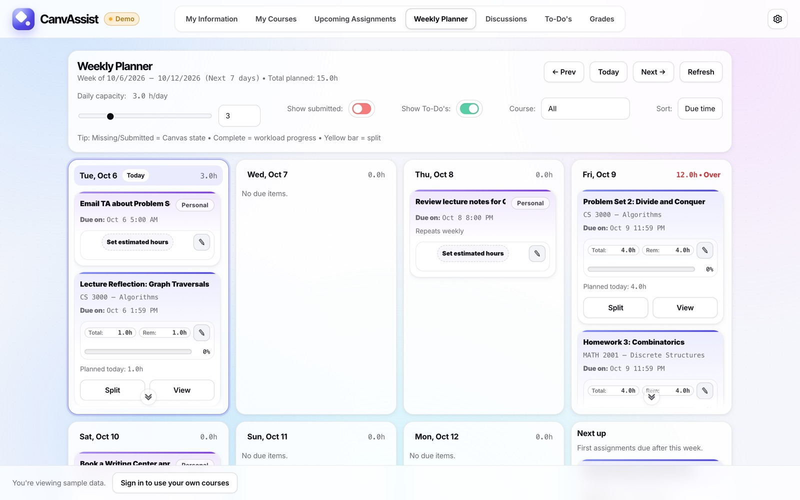
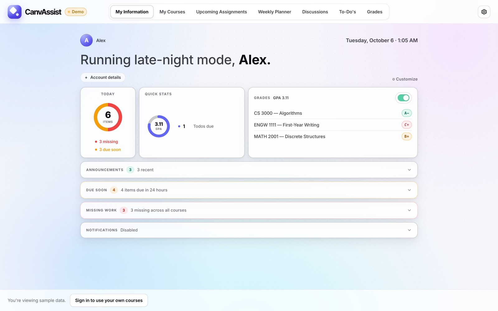
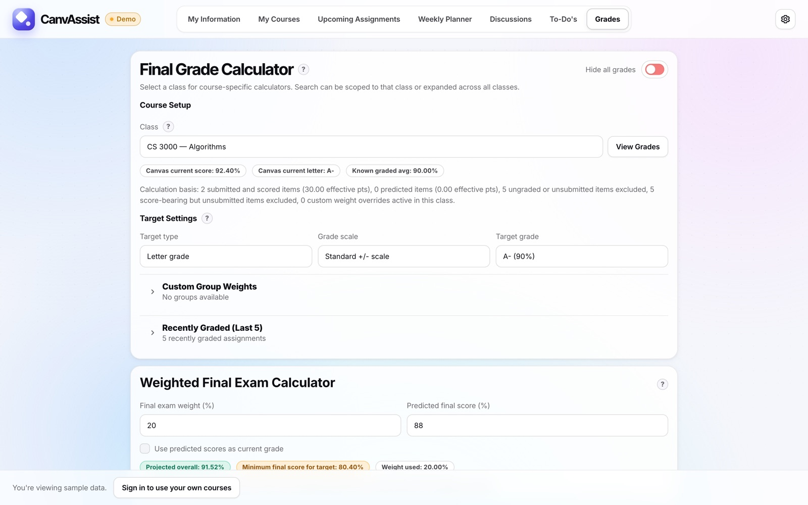
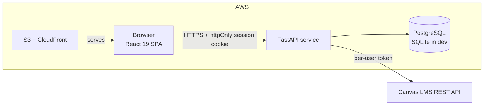

<p align="center">
  
</p>

<h1 align="center">CanvAssist</h1>

<p align="center">
  <strong>A calmer dashboard for Canvas LMS.</strong><br />
  Weekly planning with workload estimates, grade what-ifs, and every deadline in one place.
</p>

<p align="center">
  <a href="https://canvassist.com"><strong>Live site</strong></a> ·
  <a href="https://canvassist.com"><strong>Try the demo</strong></a> (no account needed)
</p>



## Why

Canvas spreads a student's week across dozens of pages: each course has its own assignments,
grades, announcements, and discussions. CanvAssist pulls all of that into one focused dashboard
and adds the planning tools Canvas doesn't have, like estimating how long assignments take and
working out what you need on the final.

## Features

- **Weekly Planner.** Assignments and personal to-dos laid out by day, with hour estimates,
  task splitting across days, and over-capacity warnings.
- **Grade calculator.** Uses real Canvas scores and assignment-group weights. Predict upcoming
  scores, override weights, and compute the minimum needed on remaining work for a target grade.
- **Upcoming & missing work.** One list across every course, cross-checked against Canvas
  submissions, with filters for missing, due-soon, and undated items.
- **Personal to-dos.** Recurring tasks (daily, weekly, monthly) that show up in the planner next
  to coursework.
- **Announcements & discussions.** Unread tracking and threaded replies without opening each course.
- **Customization.** Light, dark, and custom themes, density and font options, a configurable
  home dashboard, and hidden assignments.
- **Demo mode.** Generated sample courses so anyone can try the app without a student account.

| Home dashboard | Grade calculator |
| --- | --- |
|  |  |

## Architecture



- **Frontend** (`frontend/`): React 19 + Vite single-page app with no UI framework. The design
  system lives in `src/styles.css` as CSS custom properties, so themes are token swaps.
  `useCachedAsync` provides stale-while-revalidate caching per view.
- **Backend** (`backend/`): FastAPI app that authenticates users, stores their Canvas token, and
  proxies, caches, and enriches Canvas API calls. It fans out per-course requests in parallel and
  adds features Canvas lacks: workload estimates, to-dos, weight overrides, and completion flags.
- **Data**: SQLAlchemy models for users, sessions, encrypted Canvas tokens, to-dos, workload
  estimates, and per-user grade settings.

### Security

- Canvas personal access tokens are **encrypted at rest** with Fernet and never returned to the client.
- Passwords are hashed with **bcrypt** (12 rounds). Sessions are random tokens stored hashed in
  the database and sent as **httpOnly, Secure, SameSite** cookies.
- Auth endpoints are **rate limited** (slowapi), and password-reset tokens are single-use and expire.
- Demo sessions are **stateless HMAC-signed tokens**, isolated from real accounts and the database.

## Running locally

**Prerequisites:** Python 3.11+ and Node 20+.

```bash
# Backend: http://localhost:8000
cd backend
python -m venv .venv && source .venv/bin/activate
pip install -r requirements.txt
uvicorn app:app --reload --port 8000   # no .env needed: SQLite, local key file, email logged
```

```bash
# Frontend: http://localhost:5173
cd frontend
npm install
npm run dev
```

Open http://localhost:5173 and click **Try the live demo**, or create an account and paste a
Canvas access token (Canvas → Account → Settings → *New Access Token*).

In dev, the frontend talks to `http://localhost:8000` by default. Set `VITE_API_BASE_URL` to
point it somewhere else.

### Backend configuration

| Variable | Purpose | Default |
| --- | --- | --- |
| `DATABASE_URL` | SQLAlchemy URL (Postgres in production) | local SQLite file |
| `TOKEN_ENCRYPTION_KEY` | Fernet key for Canvas tokens; **required and stable in production** | generated to a local file |
| `CANVAS_BASE_URL` | Canvas instance | `https://northeastern.instructure.com` |
| `ALLOWED_ORIGINS` | Comma-separated CORS origins | `http://localhost:5173` |
| `SECURE_COOKIES` | `true` behind HTTPS | `false` |
| `FRONTEND_BASE_URL` | Used to build password-reset links | `http://localhost:5173` |
| `SMTP_HOST`, `SMTP_PORT`, `SMTP_USERNAME`, `SMTP_PASSWORD`, `SMTP_USE_TLS`, `MAIL_FROM` | Password-reset email; without `SMTP_HOST`, reset links are logged instead | unset |
| `CACHE_TTL_SECONDS`, `SYNC_INTERVAL_SECONDS` | Canvas response cache and background refresh | `600`, `180` |

See [`backend/.env.example`](backend/.env.example) for a production template.

## Project structure

```
backend/
  app.py            FastAPI routes, Canvas client, caching, demo data
  auth.py           SQLAlchemy models, password/session/token handling
frontend/
  src/pages/        One component per tab (planner, grades, upcoming, ...) plus auth screens
  src/components/   Tabs, settings modal, workload estimate control, shared UI
  src/hooks/        useAuth, useCachedAsync, desktop notifications
  src/lib/          Client-side stores (to-dos, workload estimates, widget config)
  src/styles.css    Design tokens and component styles
docs/
  deployment.md     How production is built and deployed
```

## Deployment

The frontend builds with GitHub Actions and is deployed to S3 behind CloudFront. The backend runs
on AWS with PostgreSQL. See [docs/deployment.md](docs/deployment.md).

## Status

CanvAssist is an independent student project in beta. Accounts are currently limited to
Northeastern University's Canvas instance. It is not affiliated with Instructure or Canvas.

## License

[MIT](LICENSE)
